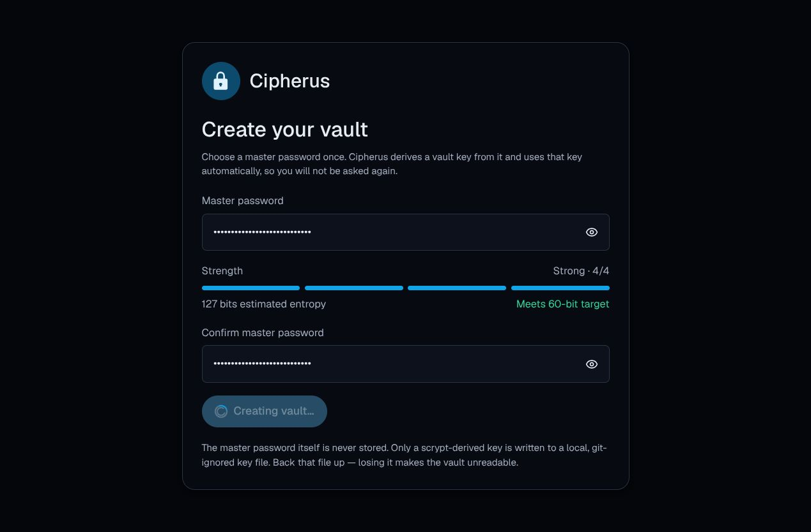
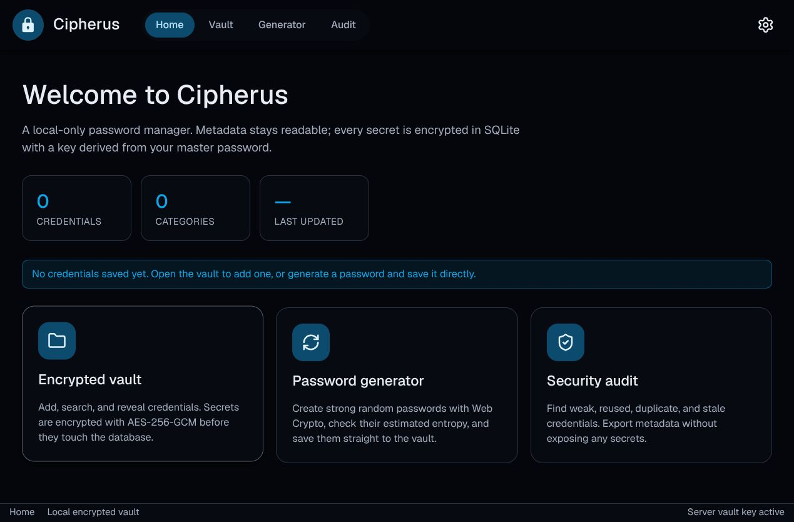
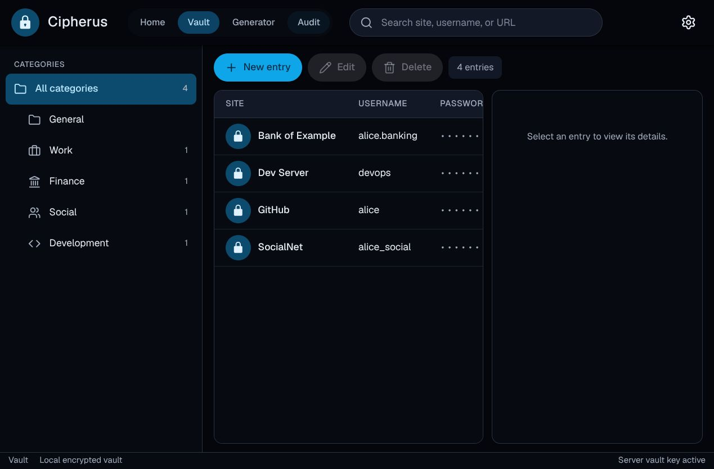
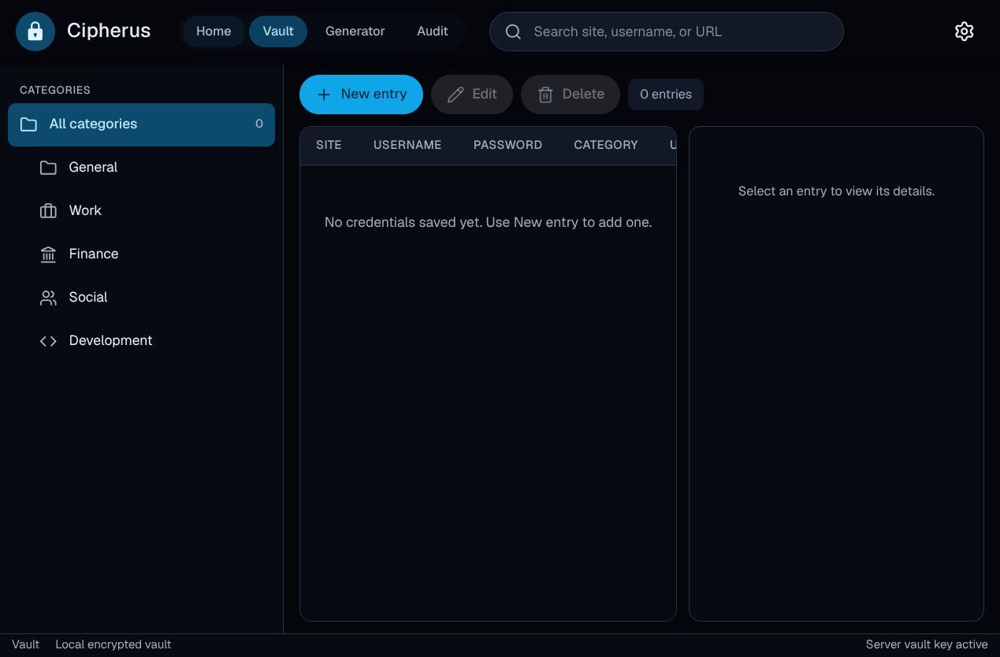
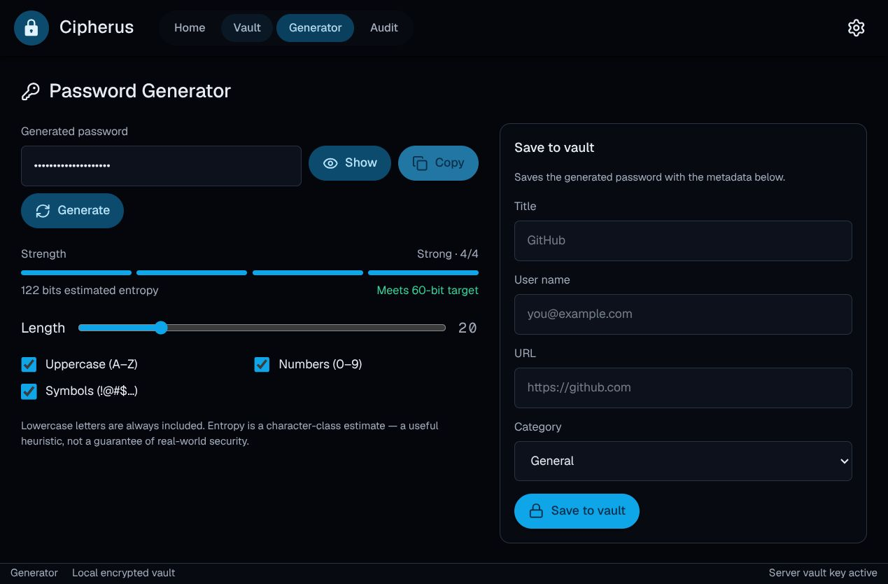
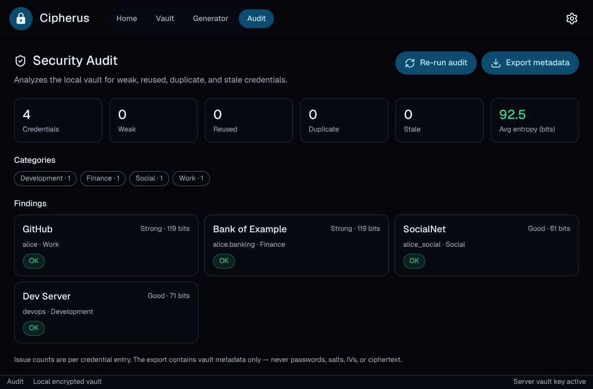
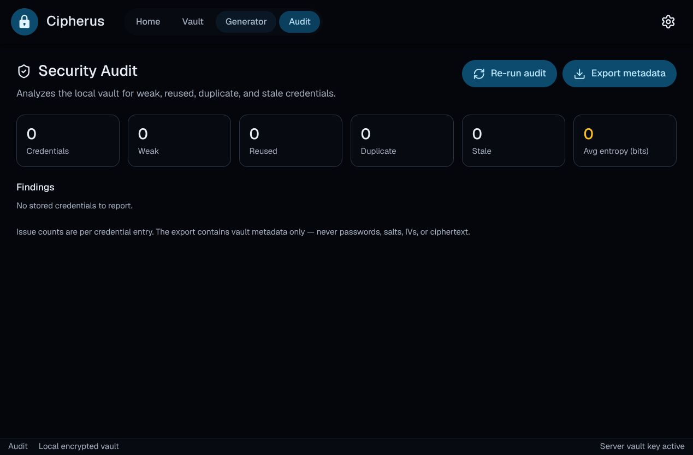

# Cipherus

A local-only password manager. Credentials are encrypted with AES-256-GCM and stored in SQLite. You set a master password once; after that the app unlocks itself from a local key file.









## Requirements

- Node.js 20+
- pnpm

## Setup

```bash
pnpm install
pnpm exec drizzle-kit push
```

## Run

```bash
pnpm dev
```

Open <http://127.0.0.1:3000>.

On first launch, create a master password (12+ characters). The app saves a derived key to `.cipherus/vault.key` and never stores the password.

## Build

```bash
pnpm build
pnpm start
```

Both scripts bind to `127.0.0.1`.

## Safety

- The API has no login while the server runs. Keep it local.
- Never commit `.cipherus/`, `*.key`, or `*.db`.
- Back up the database and key file together. Losing the key makes existing entries unreadable.

## Docs

- [Using Cipherus](docs/usage.md)
- [Contributing](CONTRIBUTING.md)
